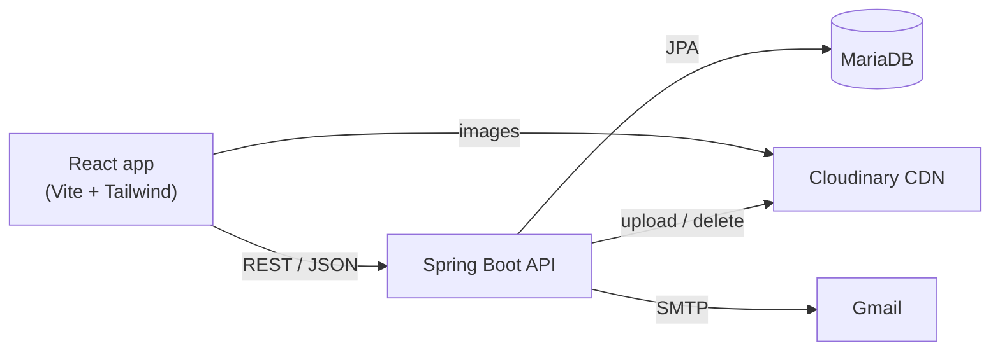

# Dušan Team: website for a local painting business

A full-stack website I built to support a friend's local business: **Dušan Team**, a wall painting
and decorating crew from Serbia. Visitors can browse the team's work, read about them and send a
message. The owner keeps the site up to date himself through a password-protected admin panel,
without touching any code.

The site is in Serbian; the code and documentation are in English.

## Features

**Public website**
- **Home**: full-screen slideshow of recent work with captions
- **Gallery**: photo grid with a full-screen viewer (arrows, counter, works with portrait photos)
- **About us**: story and four feature boxes, all editable from the admin panel
- **Contact**: form that saves the message and emails it to the business (reply goes straight to the visitor), plus phone and email links
- Responsive layout with a mobile menu

**Admin panel** (`/admin`)
- Edit the 4 home page slides (image + caption)
- Edit every text on the About page
- Upload several gallery photos at once, delete photos
- Images are stored on Cloudinary's CDN, so the server stays light and photos load fast

## Tech stack

| Layer | Technologies |
|---|---|
| Frontend | React 19, React Router 7, Vite 7, Tailwind CSS 4 |
| Backend | Java 17, Spring Boot 4 (Web MVC, Data JPA, Security, Mail, Validation), Lombok |
| Database | MariaDB (tables created by Hibernate) |
| Images | Cloudinary (upload, CDN delivery, deletion) |
| Email | Gmail SMTP via Spring Mail |
| Dev / deploy | Docker Compose, nginx, Maven wrapper |

## Architecture



The backend follows a layered design: **controller → service → repository**, with DTOs at the API
boundary and a global exception handler that turns errors into proper HTTP status codes.

**Security**
- Public `GET` endpoints for the website; every change (upload, edit, delete) requires the admin role
- HTTP Basic authentication with a BCrypt-hashed admin password
- No secrets in the repository: every password and API key comes from environment variables or a gitignored local file
- If no admin password is configured, a random one is generated at startup (never a default password)
- CORS restricted to the configured frontend origins; server-side validation of contact messages

## Project structure

```
dusan-team/
├── backend/dusanteam-backend/      Spring Boot API
│   ├── src/main/java/com/dusanteam/dusanteam_backend/
│   │   ├── config/                 security, CORS, Cloudinary
│   │   ├── controller/             REST endpoints
│   │   ├── service/                business logic (+ impl/)
│   │   ├── repository/             Spring Data JPA
│   │   ├── entity/  dto/           database models, API models
│   │   └── exception/              error handling
│   ├── src/main/resources/application.properties   (no secrets)
│   └── application-local.properties.example        your local settings template
├── frontend/dt-front/              React app
│   ├── src/components/             pages: Home, Gallery, About, Contact, Admin
│   ├── src/config.js               API address and contact details
│   └── public/                     logo and background images
└── docker-compose.yml              runs everything with one command
```

## Running it locally

### Option 1: Docker (easiest)

Needs [Docker Desktop](https://www.docker.com/products/docker-desktop/).

```
docker compose up --build
```

Open http://localhost:8000. MariaDB, the backend and the website start together.
The admin panel is at http://localhost:8000/admin: since no admin password is set, one is generated
for you; find it with `docker compose logs backend`.

To upload images or send emails, copy `.env.example` to `.env`, fill in your Cloudinary and Gmail
keys (and an admin password), and start again.

### Option 2: Run each part yourself

Needs **Java 17+**, **Node.js 22**, and **MariaDB** running on port 3306.

**1. Backend**

```
cd backend/dusanteam-backend
copy application-local.properties.example application-local.properties
```

Open `application-local.properties` and fill in at least your MariaDB password and an admin
password. Cloudinary and Gmail are optional (see [Configuration](#configuration)). This file is
gitignored, so your passwords stay on your computer. Then start the API:

```
mvnw spring-boot:run
```

(or run `DusanteamBackendApplication` from IntelliJ). The `dusanteam` database and its tables are
created automatically. The API runs on http://localhost:8080.

**2. Frontend**

```
cd frontend/dt-front
npm install
npm run dev
```

Open http://localhost:5173, and http://localhost:5173/admin to log in and add content.
The frontend expects the API on `http://localhost:8080`; to change that, copy `.env.example` to
`.env` and edit `VITE_API_URL`.

> These commands are for Windows `cmd`. In PowerShell use `.\mvnw`; on macOS / Linux use `cp` and `./mvnw`.

## Configuration

The backend reads these environment variables. For local development you can set the same values in
`application-local.properties` instead (see the example file).

| Variable | Purpose | Default |
|---|---|---|
| `DB_URL` | JDBC URL of the database | `jdbc:mariadb://localhost:3306/dusanteam` |
| `DB_USER` / `DB_PASSWORD` | database login | `root` / empty |
| `ADMIN_USERNAME` / `ADMIN_PASSWORD` | admin panel login | `admin` / generated at startup |
| `CLOUDINARY_NAME` / `CLOUDINARY_KEY` / `CLOUDINARY_SECRET` | image hosting ([free account](https://cloudinary.com)) | empty: uploads disabled |
| `MAIL_USERNAME` / `MAIL_PASSWORD` | Gmail address and [app password](https://support.google.com/accounts/answer/185833) for contact emails | empty: messages only saved in the database |
| `ALLOWED_ORIGINS` | comma-separated frontend URLs allowed to call the API | `http://localhost:5173` |

Frontend: `VITE_API_URL` (in `frontend/dt-front/.env`) is the address of the API.

## API overview

| Method | Endpoint | Access | Description |
|---|---|---|---|
| GET | `/api/slides` | public | home page slides |
| POST | `/api/slides` | admin | add a slide (`text`, `file`), max 4 |
| PUT | `/api/slides/{id}` | admin | edit a slide's text and/or image |
| DELETE | `/api/slides/{id}` | admin | delete a slide and its image |
| GET | `/api/gallery` | public | all gallery images |
| POST | `/api/gallery/multiple` | admin | upload several images (`files`) |
| DELETE | `/api/gallery/{id}` | admin | delete an image (also from Cloudinary) |
| GET | `/api/texts/page/{prefix}` | public | all texts of a page, e.g. `about_` |
| PUT | `/api/texts/{key}` | admin | create or update a text (plain-text body) |
| POST | `/api/contact` | public | send a message (`email`, `message`) |
| GET | `/api/admin/check` | admin | verify admin credentials |

## Updating an existing database

Hibernate adds new columns automatically, but it doesn't change existing ones. If your database was
created by an older version, run this once so long contact messages fit:

```sql
ALTER TABLE contact_messages MODIFY message TEXT NOT NULL;
```

## Credits

Designed and developed by **Momčilo Petković**, for Dušan Team.
The final review before publishing (security hardening, bug fixes, Docker setup and this
documentation) was done with help from Claude (Anthropic).
